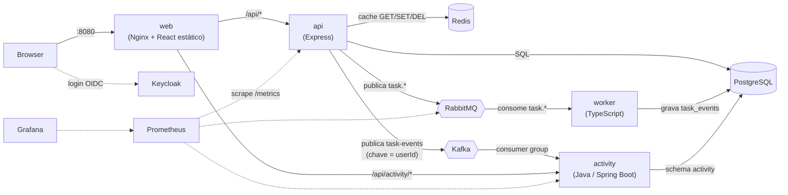

# Workshop: Aplicação Fullstack por Dentro

Este workshop usa **uma aplicação real e pequena** (um gestor de tarefas) para te ensinar cada peça de um sistema moderno: frontend, API, base de dados, cache, fila de mensagens, worker, containers e proxy.

O objetivo **não** é decorar comandos. É que no fim consigas:

1. Explicar **porque** cada peça existe e o que acontece se ela falhar.
2. Ler qualquer ficheiro do projeto e saber o que ele faz e onde se liga ao resto.
3. Escrever um ficheiro novo (Dockerfile, migração, consumidor, rota) sem copiar às cegas.
4. Avaliar **trade-offs** e defender uma escolha técnica com argumentos.

---

## Passo 0: faz fork deste repositório

**Antes de tocares em qualquer ficheiro:** faz **fork** deste repositório para a tua conta do GitHub, e clona o **fork** (não este repositório diretamente).

```bash
# No GitHub: botão "Fork" nesta página. Depois, na tua máquina:
git clone git@github.com:<o-teu-utilizador>/Claude-Workshop.git
cd Claude-Workshop
```

Porquê antes de tudo o resto:

- Este repositório é o **template**: fica sempre intacto, no estado em que o começaste a estudar.
- Todos os exercícios do módulo 11 (mudar, partir, estender) alteram ficheiros. Se os fizeres aqui diretamente, não tens como voltar ao ponto de partida sem perder o que já escreveste.
- No teu fork podes usar Git **a sério**: um branch por exercício, commits, PRs para ti próprio, tal como o módulo 15 descreve. É o próprio exercício de Git que esse módulo pede.
- Se algo correr muito mal no fork, apagas e fazes fork de novo — o template nunca é afetado.

A partir daqui, sempre que este índice ou outro módulo disser "a partir da raiz do projeto", é a raiz do **teu fork clonado**.

---

## Arquitetura



Fluxo de um clique em "concluir tarefa":

1. O **React** envia `PATCH /api/tasks/3` ao browser → `fetch`.
2. O **Nginx** recebe em `:8080` e reencaminha `/api/*` para a **API**.
3. A **API** valida o pedido, atualiza o **PostgreSQL**, apaga a **cache Redis** e publica um evento `task.completed` no **RabbitMQ**. Responde `200` já.
4. O **worker** recebe o evento da fila, grava-o em `task_events` (uma vez só) e fica feito.
5. A **estatística** "processadas pelo worker" só sobe **depois**, quando o worker acabou. Isto é **consistência eventual**, e vais perceber porquê.

---

## Mapa do projeto

| Caminho | Responsabilidade |
|---|---|
| `src/web/` | Frontend React + Vite. Imagem final é só Nginx com ficheiros estáticos |
| `src/web/nginx.conf` | Serve a SPA e faz reverse proxy de `/api` |
| `src/api/src/index.js` | **Ponto de composição**: liga as peças concretas |
| `src/api/src/app.js` | Pipeline Express (middlewares, rotas, erros) |
| `src/api/src/routes/` | Camada HTTP: pedido → serviço → resposta |
| `src/api/src/services/` | Regras de negócio (cache + BD + eventos) |
| `src/api/src/repositories/` | Todo o SQL, num único sítio |
| `src/api/src/db/migrations/` | Evolução do schema, versionada |
| `src/api/src/cache/` | Wrapper do Redis (cache-aside) |
| `src/api/src/messaging/` | Publicação de eventos no RabbitMQ |
| `src/worker/src/` | Consumidor de eventos com idempotência e DLQ |
| `config/docker-compose.yml` | Orquestra os 6 serviços |
| `scripts/smoke-test.sh` | Prova que o fluxo completo funciona |
| `src/api/src/services/authService.js` | Registo, login, JWT e hash de passwords |
| `src/api/src/middleware/auth.js` | Exige token válido nas rotas de tarefas |
| `src/api/test/integration/` | Testes contra Postgres real |
| `src/worker/src/*.ts` | Worker em TypeScript (compilado para `dist/`) |
| `.github/workflows/ci.yml` | Pipeline de CI: testes, build, integração e teste de fumo |
| `config/k8s/api.yaml` | Deployment e Service da API para Kubernetes |
| `config/keycloak/realm-workshop.json` | Realm do Keycloak (cliente, utilizador de teste), importado no arranque |
| `src/api/src/services/oidcVerifier.js` | Verificação de tokens do Keycloak (RS256 + JWKS) |
| `src/web/src/oidc.js` | Login com Keycloak no browser (Authorization Code + PKCE) |
| `src/api/openapi.yaml` | Contrato da API (OpenAPI), servido pelo Swagger UI |
| `tests/e2e/` | Testes E2E com Playwright (browser real) |
| `src/activity/` | Microserviço **Java/Spring Boot**: consome Kafka, JPA + Flyway, Spring Security (RBAC) |
| `src/api/src/messaging/kafkaPublisher.js` | Publicação no **Kafka** (chave = userId) |
| `src/api/src/observability/metrics.js` | Métricas Prometheus da API |
| `config/prometheus/`, `config/grafana/` | Scrape, alertas, fonte de dados e dashboard (como código) |
| `.github/workflows/ci.yml` | Pipeline de CI lido linha a linha no módulo 19 |

---

## Roteiro

| # | Módulo | Peça principal | Tempo sugerido |
|---|---|---|---|
| 01 | [Fundamentos](01-fundamentos.md) | HTTP, REST, Node, Express | 2 h |
| 02 | [Docker](02-docker.md) | Imagens, contentores, compose | 3 h |
| 03 | [PostgreSQL](03-postgresql.md) | Schema, SQL seguro, migrações | 2 h |
| 04 | [API em camadas](04-api-em-camadas.md) | Routes, services, repositories, DI | 2 h |
| 05 | [Cache com Redis](05-redis-e-cache.md) | Cache-aside, TTL, invalidação | 1,5 h |
| 06 | [Mensagens com RabbitMQ](06-mensagens-rabbitmq.md) | Exchanges, ack, DLQ, idempotência | 3 h |
| 07 | [O Worker](07-worker.md) | Consumidor, falhas, escala | 1,5 h |
| 08 | [Frontend com React](08-frontend-react.md) | Componentes, estado, efeitos | 2 h |
| 09 | [Nginx, proxy e origem](09-nginx-proxy-e-origem.md) | Reverse proxy, CORS, SPA | 1 h |
| 10 | [Testes e observabilidade](10-testes-e-observabilidade.md) | Pirâmide, fakes, logs, health | 2 h |
| 11 | [Exercícios](11-exercicios.md) | Mudar, partir e estender | ∞ |
| 12 | [Decisões e trade-offs](12-decisoes-e-trade-offs.md) | Pensamento crítico | 1,5 h |
| 13 | [Competências de mercado](13-competencias-mercado.md) | O que está coberto e o que falta | 1 h + exercícios D1–D8 |
| 14 | [Autenticação: manual vs Keycloak](14-autenticacao-manual-vs-keycloak.md) | OIDC, PKCE, JWKS, SSO | 2 h |
| 15 | [Trabalhar numa empresa](15-trabalhar-numa-empresa.md) | Ferramentas da indústria, Git, PRs, entrevistas | 2 h |
| 16 | [Kafka](16-kafka.md) | Log, partições, consumer groups, DLT | 3 h |
| 17 | [Java e Spring Boot](17-spring-boot.md) | DI, JPA, Flyway, Spring Security, testes | 4 h |
| 18 | [Prometheus e Grafana](18-observabilidade-prometheus-grafana.md) | Métricas, PromQL, dashboards, alertas | 2 h |
| 19 | [CI/CD com GitHub Actions](19-ci-cd-github-actions.md) | Jobs, services, cache, artefactos, OIDC | 2,5 h |

Podes fazer por ordem. Os módulos 02, 03 e 06 são os mais densos.

---

## Como estudar (o método importa mais do que o conteúdo)

Para cada módulo:

1. **Lê** a teoria.
2. **Abre** os ficheiros indicados e lê-os **antes** de ler a explicação do que fazem.
3. **Corre** o sistema e observa o comportamento.
4. **Quebra** de propósito uma coisa (há sugestões em cada módulo).
5. **Responde** às perguntas de pensamento crítico **sem olhar** para as soluções.
6. Só depois abre as soluções (estão em `<details>`).

> **Regra de ouro:** se não consegues explicar, linha a linha, o que um ficheiro faz e o que aconteceria se essa linha não existisse, ainda não o percebeste.

---

## Pré-requisitos e arranque

Precisas de: **Docker** (com o daemon a correr), **Node.js 22+** e **npm** (para os testes e para desenvolver fora do Docker).

```bash
# Arrancar tudo (a partir da raiz do projeto)
docker compose -f config/docker-compose.yml up --build -d

# Se a porta 8080 estiver ocupada noutro projeto: WEB_PORT=8081 docker compose -f ... up --build -d
# Em qualquer ambiente real, define o teu segredo JWT: JWT_SECRET=... docker compose ...

# Verificar que funciona (cria um utilizador de teste e percorre o fluxo)
./scripts/smoke-test.sh          # ou: BASE_URL=http://localhost:8081 ./scripts/smoke-test.sh

# Abrir a aplicação:       http://localhost:8080 (ou a porta que escolheste)
# Painel do RabbitMQ:      http://localhost:15672   (utilizador: workshop / password: workshop)
# Keycloak (consola):      http://localhost:8180    (admin / admin)  · utilizador da app: alice / alice-password
# Swagger UI (API):        http://localhost:8088
# Kafka UI:               http://localhost:8089
# Prometheus:             http://localhost:9090
# Grafana:                http://localhost:3001   (dashboard abre logo; editar: admin / admin)
# Utilizadora admin:       carla / carla-password  (acede a /api/activity/*)

# Testes E2E (browser real, numa imagem Docker do Playwright; com o sistema a correr)
cd tests/e2e && npm install && docker run --rm --network host -v "$PWD:/e2e" -w /e2e \
  -e BASE_URL=http://localhost:8080 mcr.microsoft.com/playwright:v1.63.0-noble npx playwright test

# Ver logs de um serviço
docker compose -f config/docker-compose.yml logs -f worker

# Desligar (mantém os dados da BD)
docker compose -f config/docker-compose.yml down
```

> **Memória:** o sistema completo tem 4 JVMs (Keycloak, Kafka, Kafka UI, Spring). O compose define limites (`mem_limit` e heaps da JVM): o stack inteiro usa cerca de 2–2,5 GiB, por isso cabe numa VM do Docker de 4 GB. Com menos, ou com outros projetos a correr, os serviços são mortos (código 137). Confirma em Docker Desktop → Settings → Resources. O Kafka UI (`kafka-ui`) é o primeiro a dispensar se faltar RAM.

Testes (sem Docker, exceto a integração):

```bash
cd src/api    && npm test                 # unitários
cd src/api    && DATABASE_TEST_URL=... npm run test:integration   # contra Postgres real
cd src/worker && npm test                 # compila o TypeScript e corre os testes
```

Novidades desta versão: **autenticação** (módulo 04 e 13), **CI** (`.github/workflows/ci.yml`), **testes de integração**, **worker em TypeScript** (módulo 07) e **Kubernetes** (`config/k8s/`). O estado de cada competência está no [módulo 13](13-competencias-mercado.md).

---

## Autoavaliação: testa-te a sério

Ler e assentir com a cabeça não é a mesma coisa que saber. Há duas formas, que são o mesmo conteúdo:

- **No próprio módulo:** cada ficheiro `docs/0X-*.md` termina com um "Quiz rápido" — perguntas **só daquele módulo**, com a resposta escondida em `<details>`, para leres sem precisar do terminal.
- **No terminal, com correção automática:**
  ```bash
  node scripts/quiz.mjs status   # vê o teu progresso (fica num ficheiro local, fora do Git)
  node scripts/quiz.mjs 06       # quiz do módulo 06 (RabbitMQ) — só perguntas desse módulo
  node scripts/quiz.mjs geral    # perguntas GERAIS, que ligam vários módulos entre si
  node scripts/quiz.mjs exame    # exame final: 2 perguntas de cada módulo + TODAS as gerais
  ```

As duas vêm do mesmo ficheiro (`scripts/quiz-questions.json`), gerado para os `.md` por `scripts/generate-quiz-docs.mjs` — nunca edites o texto entre `<!-- quiz:start -->

## Quiz rápido (perguntas gerais)

Estas perguntas ligam vários módulos entre si: não substituem o quiz de cada módulo, somam-se a ele. Fazem mais sentido depois de teres passado pela maioria dos módulos. Versão interativa e corrigida automaticamente: `node scripts/quiz.mjs geral`.

**1.** Entre o RabbitMQ (worker), o Kafka (activity) e as migrações do Postgres, qual é o padrão COMUM que garante que repetir a mesma operação não duplica o efeito?

- a) Um mutex global que bloqueia o processo inteiro
- b) INSERT ... ON CONFLICT DO NOTHING (ou equivalente) sobre uma chave única, decidido atomicamente pela própria base de dados
- c) Um temporizador que ignora pedidos repetidos durante alguns segundos
- d) Não há padrão comum: cada um resolve o problema de forma totalmente diferente

<details><summary>Resposta</summary>

**b) INSERT ... ON CONFLICT DO NOTHING (ou equivalente) sobre uma chave única, decidido atomicamente pela própria base de dados** — Idempotência resolvida empurrando a decisão para a BD — módulos 03, 06, 07, 16, 17.

</details>

**2.** O login manual (JWT HS256) e o login pelo Keycloak (JWT RS256) resolvem o mesmo problema de formas diferentes. Qual é a diferença essencial, em termos de quem pode EMITIR um token válido?

- a) Não há diferença real, é só uma troca de nome
- b) Com HS256 há um segredo PARTILHADO: quem o conhece consegue emitir e verificar; com RS256, só quem tem a chave PRIVADA emite, e qualquer um com a chave pública só consegue verificar
- c) RS256 é apenas uma versão mais lenta do HS256
- d) HS256 só funciona em Node.js; RS256 só funciona em Java

<details><summary>Resposta</summary>

**b) Com HS256 há um segredo PARTILHADO: quem o conhece consegue emitir e verificar; com RS256, só quem tem a chave PRIVADA emite, e qualquer um com a chave pública só consegue verificar** — Liga os módulos 04, 14 e 17 (o Spring também só verifica, nunca emite, tokens do Keycloak).

</details>

**3.** Se o RabbitMQ E o Kafka estiverem ambos em baixo, mas o Postgres e o Redis continuarem saudáveis, o que acontece a um POST /api/tasks?

- a) A API fica completamente em baixo e devolve 503 a todos os pedidos
- b) A tarefa é criada com sucesso (Postgres e Redis continuam saudáveis), mas a API devolve 500 porque a publicação no RabbitMQ é obrigatória — o dual-write problem a manifestar-se
- c) A tarefa não é criada e a API devolve 404
- d) Nada acontece, o pedido fica em espera indefinidamente

<details><summary>Resposta</summary>

**b) A tarefa é criada com sucesso (Postgres e Redis continuam saudáveis), mas a API devolve 500 porque a publicação no RabbitMQ é obrigatória — o dual-write problem a manifestar-se** — Liga os módulos 04, 06, 12 e 16: o Kafka é best-effort, mas o RabbitMQ não é.

</details>

**4.** Porque é que tanto o resolver dinâmico do Nginx (módulo 09) como o JWKS do Keycloak (módulo 14) existem — ambos voltam a pedir informação periodicamente em vez de a guardar para sempre?

- a) Por acaso; não há nenhum motivo técnico comum entre os dois
- b) Porque o que está do outro lado pode mudar (a API é recriada com outro IP; o Keycloak pode rodar as suas chaves), e confiar num valor guardado para sempre causaria falhas (502) ou tokens recusados sem motivo aparente
- c) Porque o DNS é sempre lento e por isso tem de se repetir
- d) Só por uma questão de segurança contra ataques, sem mais nenhuma razão

<details><summary>Resposta</summary>

**b) Porque o que está do outro lado pode mudar (a API é recriada com outro IP; o Keycloak pode rodar as suas chaves), e confiar num valor guardado para sempre causaria falhas (502) ou tokens recusados sem motivo aparente** — O mesmo problema de fundo — confiar demasiado tempo num valor que pode mudar — aparece em sítios diferentes.

</details>

**5.** O serviço Spring (activity, Kafka) e o worker (TypeScript, RabbitMQ) resolvem o mesmo tipo de problema: o que é diferente entre os dois brokers que obrigou a soluções de erro diferentes (DLQ vs Dead Letter Topic)?

- a) Nada é diferente: a solução para mensagens problemáticas é idêntica nos dois
- b) No RabbitMQ, nack(requeue=false) rejeita a mensagem individualmente; no Kafka, como a entrega é por ORDEM dentro da partição, é o próprio consumidor que publica explicitamente no Dead Letter Topic para poder avançar o offset
- c) O Kafka não tem nenhum mecanismo equivalente a uma dead letter
- d) O RabbitMQ não permite rejeitar mensagens

<details><summary>Resposta</summary>

**b) No RabbitMQ, nack(requeue=false) rejeita a mensagem individualmente; no Kafka, como a entrega é por ORDEM dentro da partição, é o próprio consumidor que publica explicitamente no Dead Letter Topic para poder avançar o offset** — Liga os módulos 06, 07 e 16.

</details>

**6.** O cache do Redis (módulo 05) e a cache do npm/Maven no CI (módulo 19) partilham o mesmo princípio. Qual?

- a) Não têm nenhum princípio em comum, são tecnologias completamente diferentes
- b) Guardar o resultado de um trabalho caro (uma query à BD; descarregar dependências) para o reutilizar, com uma forma de saber quando deixa de ser válido (TTL; hash do lock file)
- c) Os dois usam exatamente a mesma tecnologia por dentro
- d) Servem só para reduzir a fatura da cloud, sem efeito na velocidade

<details><summary>Resposta</summary>

**b) Guardar o resultado de um trabalho caro (uma query à BD; descarregar dependências) para o reutilizar, com uma forma de saber quando deixa de ser válido (TTL; hash do lock file)** — O mesmo padrão de cache aparece em camadas muito diferentes do sistema.

</details>

**7.** Olhando para os módulos 02 (Docker), 17 (Spring) e 19 (CI), qual é a ideia REPETIDA sobre como lidar com ferramentas que só servem para construir, não para correr?

- a) Não há ideia repetida entre os três módulos
- b) O padrão multi-stage/separação: uma fase com as ferramentas pesadas de construção (compilador, Maven), e só o resultado final (dist/, JAR, imagem) fica no sítio onde a aplicação corre
- c) Os três exigem exatamente o mesmo Dockerfile
- d) Só se aplica a Java, nunca a Node ou a pipelines de CI

<details><summary>Resposta</summary>

**b) O padrão multi-stage/separação: uma fase com as ferramentas pesadas de construção (compilador, Maven), e só o resultado final (dist/, JAR, imagem) fica no sítio onde a aplicação corre** — É a mesma lógica do Dockerfile multi-stage, aplicada ao build do Maven e à imagem final do CI.

</details>

**8.** Porque é que tantos módulos (03 migrações, 07 worker, 16 Kafka, 17 Flyway) insistem em dizer 'nunca edites algo já aplicado, cria um novo'?

- a) É só um costume do Git, sem nenhuma razão técnica
- b) Porque outros ambientes (produção, outros colegas) já podem ter aplicado a versão antiga; editá-la depois criaria divergência entre quem aplicou a V1 original e quem aplicasse a V1 editada
- c) Torna o histórico do Git mais lento a carregar
- d) É uma limitação específica do PostgreSQL, não se aplica a outras bases de dados

<details><summary>Resposta</summary>

**b) Porque outros ambientes (produção, outros colegas) já podem ter aplicado a versão antiga; editá-la depois criaria divergência entre quem aplicou a V1 original e quem aplicasse a V1 editada** — O mesmo raciocínio aparece em migrações SQL, eventos e versões de configuração.

</details>

**9.** Pensando no sistema completo (módulos 01-19), qual é a fraqueza mais correta a apontar, mesmo depois de todas as correções feitas durante o workshop?

- a) Não existe nenhuma fraqueza; o sistema está pronto para produção tal como está
- b) O dual-write entre a base de dados e o RabbitMQ/Kafka continua sem outbox: uma falha momentânea do broker ainda causa uma inconsistência visível ao utilizador
- c) O projeto não tem testes automatizados nenhuns
- d) Falta usar Docker em algum dos serviços

<details><summary>Resposta</summary>

**b) O dual-write entre a base de dados e o RabbitMQ/Kafka continua sem outbox: uma falha momentânea do broker ainda causa uma inconsistência visível ao utilizador** — É a fraqueza que o próprio módulo 12 identifica e nunca chega a resolver — de propósito, para discutires a solução.

</details>

**10.** Em uma palavra ou expressão curta: como se chama o princípio partilhado entre o timeout-minutes do CI (módulo 19), o timeout de 2s do publisher Kafka (módulo 16) e o nack no worker (módulo 07) — nunca esperar indefinidamente por algo que pode nunca responder?

<details><summary>Resposta</summary>

**timeout** — 'Falhar depressa' em vez de ficar pendurado é mais fácil de diagnosticar e mais barato do que ficar à espera para sempre.

</details>

<!-- quiz:end -->` à mão, muda o JSON e corre o gerador.

**Cada módulo só tem perguntas dele próprio** — o quiz do módulo 06 nunca pergunta sobre Kafka. As **perguntas gerais**, no fim deste índice, são diferentes: testam se ligas conceitos de módulos diferentes (ex.: o que RabbitMQ, Kafka e as migrações do Postgres têm em comum). **Somam-se** ao quiz de cada módulo — nunca o substituem, e é por isso que o `exame` tem sempre as 2 perguntas de cada módulo *mais* todas as gerais, nunca umas em vez das outras.

Precisas de **70%** para "passar". Perguntas erradas mostram-te a resposta certa, uma explicação, e o ficheiro onde essa resposta está — não é um "falhaste, boa sorte", é um apontador de volta ao sítio certo.

**Sê honesto sobre o que isto garante:** acertar as perguntas prova que reconheces os conceitos e os factos de cada módulo. **Não prova** que consegues escrever um Dockerfile do zero, depurar uma fila a sério, ou decidir uma arquitetura sob pressão numa entrevista. Essa parte só os **exercícios do módulo 11** testam — e aí não há correção automática: comparas o que escreveste com as soluções escondidas em `<details>`, com o teu próprio julgamento. Usa os dois juntos: o quiz para a teoria, os exercícios para a prática. Nenhum dos dois, sozinho, "garante" que aprendeste.

---

## Checklist de auto-avaliação

No fim do workshop deves conseguir, **sem consultar nada**:

- [ ] Desenhar a arquitetura de cabeça e dizer o que cada seta transporta.
- [ ] Explicar a diferença entre **imagem** e **contentor**, e o que é uma **camada**.
- [ ] Explicar porque o `package.json` é copiado antes do `src/`, no Dockerfile.
- [ ] Explicar porque o `depends_on` com `service_healthy` é diferente de `depends_on` simples.
- [ ] Explicar cache-aside e um cenário onde a cache devolve dados errados.
- [ ] Explicar `ack`, `nack`, `prefetch`, DLQ e porque a entrega é "pelo menos uma vez".
- [ ] Explicar porque o worker tem de ser **idempotente**.
- [ ] Explicar o **dual-write problem** e pelo menos uma forma de o resolver.
- [ ] Escrever uma migração nova sem editar as antigas.
- [ ] Explicar porque o React e a API funcionam na mesma origem e para que serve o Nginx.
- [ ] Dizer o que falta a este sistema para ir para produção.

<!-- quiz:start -->

## Quiz rápido (perguntas gerais)

Estas perguntas ligam vários módulos entre si: não substituem o quiz de cada módulo, somam-se a ele. Fazem mais sentido depois de teres passado pela maioria dos módulos. Versão interativa e corrigida automaticamente: `node scripts/quiz.mjs geral`.

**1.** Entre o RabbitMQ (worker), o Kafka (activity) e as migrações do Postgres, qual é o padrão COMUM que garante que repetir a mesma operação não duplica o efeito?

- a) Um mutex global que bloqueia o processo inteiro
- b) INSERT ... ON CONFLICT DO NOTHING (ou equivalente) sobre uma chave única, decidido atomicamente pela própria base de dados
- c) Um temporizador que ignora pedidos repetidos durante alguns segundos
- d) Não há padrão comum: cada um resolve o problema de forma totalmente diferente

<details><summary>Resposta</summary>

**b) INSERT ... ON CONFLICT DO NOTHING (ou equivalente) sobre uma chave única, decidido atomicamente pela própria base de dados** — Idempotência resolvida empurrando a decisão para a BD — módulos 03, 06, 07, 16, 17.

</details>

**2.** O login manual (JWT HS256) e o login pelo Keycloak (JWT RS256) resolvem o mesmo problema de formas diferentes. Qual é a diferença essencial, em termos de quem pode EMITIR um token válido?

- a) Não há diferença real, é só uma troca de nome
- b) Com HS256 há um segredo PARTILHADO: quem o conhece consegue emitir e verificar; com RS256, só quem tem a chave PRIVADA emite, e qualquer um com a chave pública só consegue verificar
- c) RS256 é apenas uma versão mais lenta do HS256
- d) HS256 só funciona em Node.js; RS256 só funciona em Java

<details><summary>Resposta</summary>

**b) Com HS256 há um segredo PARTILHADO: quem o conhece consegue emitir e verificar; com RS256, só quem tem a chave PRIVADA emite, e qualquer um com a chave pública só consegue verificar** — Liga os módulos 04, 14 e 17 (o Spring também só verifica, nunca emite, tokens do Keycloak).

</details>

**3.** Se o RabbitMQ E o Kafka estiverem ambos em baixo, mas o Postgres e o Redis continuarem saudáveis, o que acontece a um POST /api/tasks?

- a) A API fica completamente em baixo e devolve 503 a todos os pedidos
- b) A tarefa é criada com sucesso (Postgres e Redis continuam saudáveis), mas a API devolve 500 porque a publicação no RabbitMQ é obrigatória — o dual-write problem a manifestar-se
- c) A tarefa não é criada e a API devolve 404
- d) Nada acontece, o pedido fica em espera indefinidamente

<details><summary>Resposta</summary>

**b) A tarefa é criada com sucesso (Postgres e Redis continuam saudáveis), mas a API devolve 500 porque a publicação no RabbitMQ é obrigatória — o dual-write problem a manifestar-se** — Liga os módulos 04, 06, 12 e 16: o Kafka é best-effort, mas o RabbitMQ não é.

</details>

**4.** Porque é que tanto o resolver dinâmico do Nginx (módulo 09) como o JWKS do Keycloak (módulo 14) existem — ambos voltam a pedir informação periodicamente em vez de a guardar para sempre?

- a) Por acaso; não há nenhum motivo técnico comum entre os dois
- b) Porque o que está do outro lado pode mudar (a API é recriada com outro IP; o Keycloak pode rodar as suas chaves), e confiar num valor guardado para sempre causaria falhas (502) ou tokens recusados sem motivo aparente
- c) Porque o DNS é sempre lento e por isso tem de se repetir
- d) Só por uma questão de segurança contra ataques, sem mais nenhuma razão

<details><summary>Resposta</summary>

**b) Porque o que está do outro lado pode mudar (a API é recriada com outro IP; o Keycloak pode rodar as suas chaves), e confiar num valor guardado para sempre causaria falhas (502) ou tokens recusados sem motivo aparente** — O mesmo problema de fundo — confiar demasiado tempo num valor que pode mudar — aparece em sítios diferentes.

</details>

**5.** O serviço Spring (activity, Kafka) e o worker (TypeScript, RabbitMQ) resolvem o mesmo tipo de problema: o que é diferente entre os dois brokers que obrigou a soluções de erro diferentes (DLQ vs Dead Letter Topic)?

- a) Nada é diferente: a solução para mensagens problemáticas é idêntica nos dois
- b) No RabbitMQ, nack(requeue=false) rejeita a mensagem individualmente; no Kafka, como a entrega é por ORDEM dentro da partição, é o próprio consumidor que publica explicitamente no Dead Letter Topic para poder avançar o offset
- c) O Kafka não tem nenhum mecanismo equivalente a uma dead letter
- d) O RabbitMQ não permite rejeitar mensagens

<details><summary>Resposta</summary>

**b) No RabbitMQ, nack(requeue=false) rejeita a mensagem individualmente; no Kafka, como a entrega é por ORDEM dentro da partição, é o próprio consumidor que publica explicitamente no Dead Letter Topic para poder avançar o offset** — Liga os módulos 06, 07 e 16.

</details>

**6.** O cache do Redis (módulo 05) e a cache do npm/Maven no CI (módulo 19) partilham o mesmo princípio. Qual?

- a) Não têm nenhum princípio em comum, são tecnologias completamente diferentes
- b) Guardar o resultado de um trabalho caro (uma query à BD; descarregar dependências) para o reutilizar, com uma forma de saber quando deixa de ser válido (TTL; hash do lock file)
- c) Os dois usam exatamente a mesma tecnologia por dentro
- d) Servem só para reduzir a fatura da cloud, sem efeito na velocidade

<details><summary>Resposta</summary>

**b) Guardar o resultado de um trabalho caro (uma query à BD; descarregar dependências) para o reutilizar, com uma forma de saber quando deixa de ser válido (TTL; hash do lock file)** — O mesmo padrão de cache aparece em camadas muito diferentes do sistema.

</details>

**7.** Olhando para os módulos 02 (Docker), 17 (Spring) e 19 (CI), qual é a ideia REPETIDA sobre como lidar com ferramentas que só servem para construir, não para correr?

- a) Não há ideia repetida entre os três módulos
- b) O padrão multi-stage/separação: uma fase com as ferramentas pesadas de construção (compilador, Maven), e só o resultado final (dist/, JAR, imagem) fica no sítio onde a aplicação corre
- c) Os três exigem exatamente o mesmo Dockerfile
- d) Só se aplica a Java, nunca a Node ou a pipelines de CI

<details><summary>Resposta</summary>

**b) O padrão multi-stage/separação: uma fase com as ferramentas pesadas de construção (compilador, Maven), e só o resultado final (dist/, JAR, imagem) fica no sítio onde a aplicação corre** — É a mesma lógica do Dockerfile multi-stage, aplicada ao build do Maven e à imagem final do CI.

</details>

**8.** Porque é que tantos módulos (03 migrações, 07 worker, 16 Kafka, 17 Flyway) insistem em dizer 'nunca edites algo já aplicado, cria um novo'?

- a) É só um costume do Git, sem nenhuma razão técnica
- b) Porque outros ambientes (produção, outros colegas) já podem ter aplicado a versão antiga; editá-la depois criaria divergência entre quem aplicou a V1 original e quem aplicasse a V1 editada
- c) Torna o histórico do Git mais lento a carregar
- d) É uma limitação específica do PostgreSQL, não se aplica a outras bases de dados

<details><summary>Resposta</summary>

**b) Porque outros ambientes (produção, outros colegas) já podem ter aplicado a versão antiga; editá-la depois criaria divergência entre quem aplicou a V1 original e quem aplicasse a V1 editada** — O mesmo raciocínio aparece em migrações SQL, eventos e versões de configuração.

</details>

**9.** Pensando no sistema completo (módulos 01-19), qual é a fraqueza mais correta a apontar, mesmo depois de todas as correções feitas durante o workshop?

- a) Não existe nenhuma fraqueza; o sistema está pronto para produção tal como está
- b) O dual-write entre a base de dados e o RabbitMQ/Kafka continua sem outbox: uma falha momentânea do broker ainda causa uma inconsistência visível ao utilizador
- c) O projeto não tem testes automatizados nenhuns
- d) Falta usar Docker em algum dos serviços

<details><summary>Resposta</summary>

**b) O dual-write entre a base de dados e o RabbitMQ/Kafka continua sem outbox: uma falha momentânea do broker ainda causa uma inconsistência visível ao utilizador** — É a fraqueza que o próprio módulo 12 identifica e nunca chega a resolver — de propósito, para discutires a solução.

</details>

**10.** Em uma palavra ou expressão curta: como se chama o princípio partilhado entre o timeout-minutes do CI (módulo 19), o timeout de 2s do publisher Kafka (módulo 16) e o nack no worker (módulo 07) — nunca esperar indefinidamente por algo que pode nunca responder?

<details><summary>Resposta</summary>

**timeout** — 'Falhar depressa' em vez de ficar pendurado é mais fácil de diagnosticar e mais barato do que ficar à espera para sempre.

</details>

<!-- quiz:end -->
