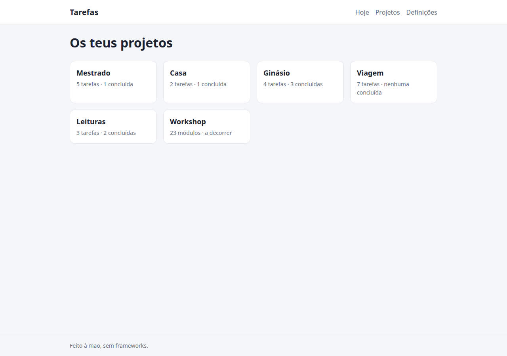
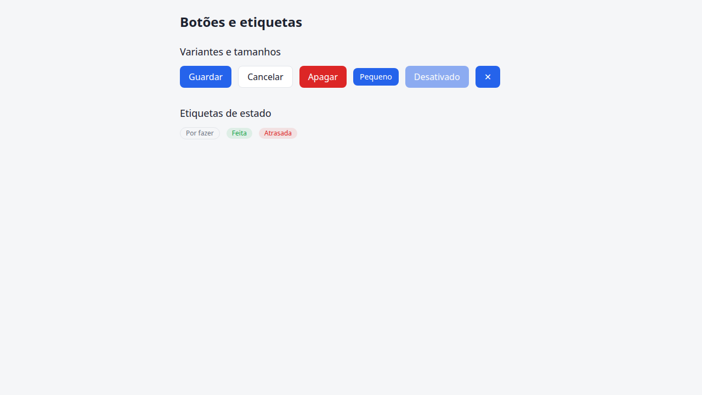
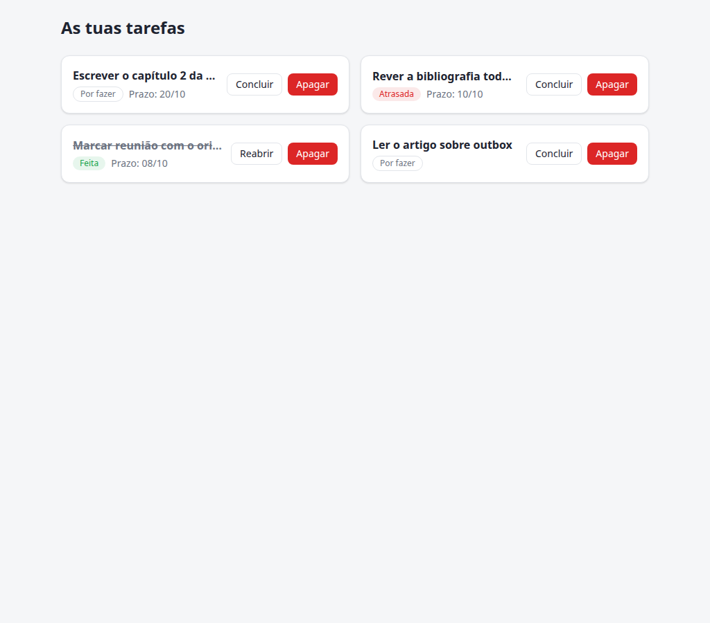
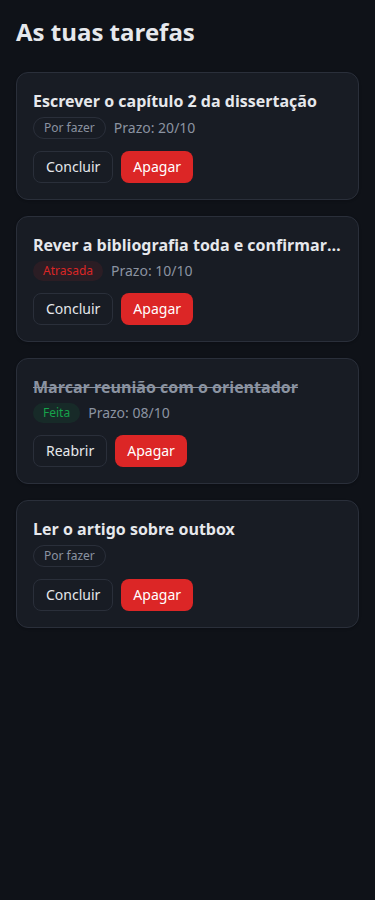

# 09 · Estilos e CSS

**Objetivo:** perceber **porque** estilizar uma interface é um problema técnico a sério (não só "gosto estético"), que opções existem no mercado, e porque este projeto escolheu Tailwind CSS. No fim, és capaz de olhar para uma classe como `rounded-lg bg-accent px-4 py-2` e saber exatamente o que cada pedaço faz — sem adivinhar.

**Ficheiros para ler (por esta ordem):** `src/web/src/styles.css` → `src/web/vite.config.js` → `src/web/src/components/TaskForm.jsx` → `src/web/src/components/AuthForm.jsx`.

---

## 1. Porque isto costuma ficar para depois

É um padrão comum: constróis a lógica (módulo 08), ela funciona, e a parte de "deixar bonito" fica para o fim — e nunca mais chega, porque parece um poço sem fundo (que cor? que espaçamento? que fonte?). Isto acontece em qualquer stack (React, Flutter, HTML puro): a lógica tem certo/errado claro (o teste passa ou não), o visual não tem essa bússola.

A boa notícia: **estilizar bem não é talento artístico, é um conjunto pequeno de decisões repetidas** — espaçamento consistente, 2-3 cores com significado, hierarquia tipográfica clara. Este módulo não te ensina design; ensina a ferramenta que torna essas decisões rápidas de aplicar e difíceis de desalinhar sem reparares.

## 2. O que já existia: CSS puro com variáveis

Antes deste módulo, `src/web/src/styles.css` era CSS tradicional: uma classe por componente (`.task-form`, `.task-list`, `.auth`), com variáveis CSS (`--bg`, `--accent`, ...) para suportar modo escuro sem JavaScript:

```css
:root {
  --accent: #2563eb;
}
@media (prefers-color-scheme: dark) {
  :root { --bg: #0f1218; }
}
.task-form input {
  border: 1px solid var(--border);
  border-radius: 8px;
}
```

Isto funciona. O problema não é técnico, é de **escala e disciplina**: cada componente novo é uma classe nova, num ficheiro que só cresce. Nada impede duas pessoas (ou tu, em dias diferentes) de escreverem `border-radius: 8px` numa classe e `border-radius: 10px` noutra, sem perceberem — o ficheiro `.css` não avisa.

## 3. As abordagens que existem no mercado

| Abordagem | Como funciona | Exemplo real |
|---|---|---|
| **CSS puro / Sass** | Classes com nomes teus, regras à mão | O `styles.css` antigo deste projeto |
| **CSS Modules** | Como CSS puro, mas cada classe é renomeada automaticamente por ficheiro — acaba o conflito de nomes entre componentes | `Button.module.css` + `import styles from './Button.module.css'` |
| **CSS-in-JS** (styled-components, Emotion) | Escreves CSS dentro do `.jsx`, como template string; a biblioteca gera classes em runtime ou build | `const Button = styled.button\`...\`;` |
| **Utility-first** (Tailwind) | Classes pequenas e pré-feitas, compostas direto no JSX; não escreves CSS novo quase nunca | `className="rounded-lg bg-accent px-4"` |

Nenhuma destas é "a errada" — são trade-offs:

- **CSS puro/Modules**: zero dependências, mas disciplina manual para manter consistência.
- **CSS-in-JS**: cores/espaçamentos vivem em JavaScript (fácil de computar dinamicamente), mas custo de performance em runtime (ou complexidade de build) e é uma abordagem em declínio no mercado desde que o CSS nativo ganhou variáveis e `:has()`.
- **Utility-first**: consistência "de fábrica" (não escreves `8px`, escreves `rounded-lg`, que é sempre o mesmo valor em todo o projeto), mas o JSX fica visualmente mais denso.

## 4. Porque Tailwind, especificamente

Pelo mesmo critério do [módulo 14](14-competencias-mercado.md): o que mais aparece em ofertas de emprego e repositórios reais, hoje. Tailwind é, de longe, a opção utility-first dominante, e tornou-se também a mais usada em geral em projetos React/Next.js novos — não porque seja "melhor" num sentido absoluto, mas porque resolve bem o problema do passo 2 (consistência) sem runtime de JavaScript (ao contrário do CSS-in-JS).

## 5. Como funciona, por dentro

```js
// vite.config.js
import tailwindcss from '@tailwindcss/vite';
export default defineConfig({
  plugins: [tailwindcss(), react()],
});
```

Isto não é um plugin que "estiliza por ti" — é um plugin que **lê o teu código-fonte** (todos os `.jsx`), procura strings que parecem classes Tailwind (`rounded-lg`, `bg-accent`, `flex`), e gera **só essas** no CSS final. Se uma classe não aparece em nenhum ficheiro, não existe no CSS enviado ao browser. É por isto que não há um "ficheiro de classes" gigante: o CSS final deste projeto tem ~8 KB, não os megabytes que a biblioteca Tailwind pesa.

```css
/* styles.css */
@import "tailwindcss";

@theme {
  --color-accent: #2563eb;
  --color-danger: #dc2626;
}
```

`@theme` é o ponto onde este projeto deixa de usar as cores "de fábrica" do Tailwind (`blue-600`, `red-600`, ...) e define as suas próprias, com nomes que significam algo aqui (`accent`, `danger`). Cada entrada faz **duas coisas ao mesmo tempo**: cria uma variável CSS normal (`--color-accent`, usável em qualquer CSS) e regista as classes `bg-accent`, `text-accent`, `border-accent`, etc. Defines a cor **uma vez**; antes (CSS puro), também era uma vez — a diferença aparece no próximo ponto.

## 6. Walkthrough: `TaskForm.jsx`, classe a classe

```jsx
<form className="mb-4 flex gap-2" onSubmit={handleSubmit}>
```
`mb-4` = `margin-bottom: 1rem` (o `4` é uma escala fixa do Tailwind: `4` → `1rem`, `2` → `0.5rem`, sempre a mesma conversão em todo o projeto — é essa a consistência "de fábrica" do passo 3). `flex` = `display: flex`. `gap-2` = `gap: 0.5rem` entre os filhos directos. Três propriedades CSS, três classes, zero CSS novo escrito.

```jsx
<input
  className="flex-1 rounded-lg border border-border bg-surface px-3 py-2 text-text"
  ...
/>
```
`flex-1` = cresce para ocupar o espaço disponível dentro do `flex` do formulário. `rounded-lg` = `border-radius` de um valor fixo (maior que `rounded` sozinho, menor que `rounded-xl`). `border` = `border-width: 1px`; `border-border` = a COR do contorno é a variável `--color-border` (repara: `border-border` parece repetido, mas não é — o primeiro `border` liga a propriedade, o segundo escolhe a cor). `bg-surface` e `text-text` fazem o mesmo para fundo e texto. `px-3 py-2` = padding horizontal/vertical.

```jsx
<button type="submit" className="rounded-lg bg-accent px-4 py-2 font-medium text-white">
  Adicionar
</button>
```
`bg-accent` usa a cor definida no `@theme` do passo 5 — se um dia mudares `--color-accent` num sítio só, este botão (e todos os outros com `bg-accent`/`text-accent`/`border-accent` no projeto) mudam juntos, sem procurares ficheiro a ficheiro. `font-medium` = `font-weight: 500`. `text-white` é uma cor "de fábrica" do próprio Tailwind (não precisa de estar no `@theme` — só as cores do **design do projeto** precisam de nome próprio).

## 7. Modo escuro sem nenhuma linha de JavaScript

```css
@media (prefers-color-scheme: dark) {
  :root {
    --color-bg: #0f1218;
    --color-surface: #181c24;
  }
}
```

As classes (`bg-bg`, `bg-surface`, ...) nunca mudam — elas só leem a variável. Sobrescrever a variável dentro do `@media` basta para toda a app mudar de tema, porque toda a gente (componentes velhos e novos) está a apontar para o mesmo sítio. Isto é o mesmo truque de antes do Tailwind (o `styles.css` original já fazia isto); o Tailwind só tornou mais difícil quebrar a consistência por acidente.

## 8. Quando NÃO vale a pena usar Tailwind

Pensamento crítico, não propaganda:

- **Protótipos muito pequenos ou de vida curta**: a curva de aprendizagem (saber os nomes das classes) não compensa para 3 divs.
- **Equipas de design que trabalham em Figma e exportam CSS**: por vezes é mais direto manter nomes de classe semânticos (`.card-header`) que mapeiam 1:1 para o design, e deixar o CSS-in-JS ou Modules tratar disso.
- **JSX muito denso**: uma linha com 10 classes utilitárias é mais difícil de ler de relance do que `className="card"`. A mitigação comum é extrair o padrão repetido para um componente (como já fazemos com `TaskList`, `TaskForm`), não para uma classe CSS nova.

---

## Prática: escreve tu

Estilos aprendem-se com o browser aberto ao lado do editor. Por isso este módulo tem duas ferramentas, e vais usar as duas ao mesmo tempo:

1. **Ver ao vivo.** Dentro de `pratica/`, corre `npm run estilos` e abre <http://localhost:5180>. Cada vez que gravas um ficheiro, a página atualiza sozinha. É aqui que se trabalha: muda, olha, ajusta.
2. **Verificar.** `npm run verificar 09` (ou só um exercício: `... 09 p1`, `... 09 p2`, `... 09 p3`) abre o **Google Chrome** sem janela e **mede** a página: larguras, posições, cores calculadas, em largura de telemóvel e de computador, em modo claro e escuro. "Está bonito" é uma opinião; "os cartões estão em 3 colunas a 1024px e numa coluna a 375px" é um facto que se testa.

Cada verificação guarda também **capturas de ecrã** em `pratica/09-estilos-css/capturas/`. Abre-as e compara com as imagens de referência abaixo. Os testes confirmam as regras; as capturas mostram se ficou com bom aspeto.

Uma curiosidade antes de começar: alguns testes passam **sem CSS nenhum** (por exemplo, "no telemóvel, o menu passa para baixo do logo"). Não é um erro. O fluxo normal do HTML já empilha tudo na vertical, que é o layout de telemóvel. É por isso que se escreve CSS **mobile-first**: começa-se do que já funciona no ecrã estreito e acrescenta-se o layout largo com `@media (min-width: ...)`.

Se nunca usaste a prática, lê primeiro a introdução no [módulo 01](01-fundamentos.md#prática-escreve-tu). Precisas do Google Chrome instalado. Sem ele, há instruções no topo de `pratica/09-estilos-css/playwright.config.js`.

### P1 · Um layout completo, só com CSS (≈60 min)

**Ficheiro:** `pratica/09-estilos-css/p1-css-puro/estilos.css` (o HTML já está feito; não lhe mexas)

Antes do Tailwind, os fundamentos. Tudo o que o Tailwind faz são propriedades CSS com outro nome, e quem domina `flex` e `grid` aprende qualquer ferramenta de estilos (incluindo o `Row`/`Column` do Flutter) numa tarde. O objetivo é chegar a isto:



As regras que o verificador mede:

- **Cores** em variáveis no `:root` (`--cor-fundo`, `--cor-superficie`, `--cor-texto`, `--cor-suave`, `--cor-destaque`, `--cor-borda`), usadas pelo `body`, e redefinidas para o **modo escuro** com `@media (prefers-color-scheme: dark)`.
- **Contentor** (`.contentor`): no máximo 960px, centrado, com 16px de margem lateral.
- **Topo**: logo à esquerda e menu à direita, na mesma linha, a partir de 640px; no telemóvel, um por baixo do outro.
- **Cartões** (`.cartoes`): uma grelha que põe tantas colunas quantas couberem, sem nenhuma media query, com 16px de intervalo e sem os marcadores da lista.
- **Cada cartão**: fundo da superfície, borda de 1px, cantos de 12px, 16px de espaço interior; ao passar o rato, sobe um pouco e ganha sombra, com transição.
- **Rodapé** colado ao fundo do ecrã, mesmo com pouco conteúdo.
- **Sem scroll horizontal** no telemóvel, e **foco visível** nos links quando se navega com Tab.

**Sintaxe que vais praticar:** `:root` e `var(--x)`, `@media (prefers-color-scheme: dark)` e `@media (min-width: 640px)`, `display: flex` com `justify-content`/`align-items`/`gap`, `display: grid` com `repeat(auto-fill, minmax(220px, 1fr))`, `max-width` + `margin-inline: auto`, `box-sizing: border-box`, `:hover`, `:focus-visible`, `transition`, `transform`.

<details>
<summary>Pista</summary>

- O rodapé colado ao fundo: põe o `body` em coluna (`display: flex; flex-direction: column; min-height: 100vh`) e dá `flex: 1` ao `main`. O `main` estica e empurra o rodapé.
- A grelha "sem media queries": `repeat(auto-fill, minmax(220px, 1fr))` quer dizer "cria quantas colunas de pelo menos 220px couberem, e divide o que sobrar entre elas".
- Se aparecer scroll horizontal no telemóvel, quase sempre é falta de `box-sizing: border-box`: sem ele, `width: 100%` mais `padding: 16px` dá 100% + 32px.
</details>

<details>
<summary>Solução de referência</summary>

```css
/* 1. Tokens: todas as cores e medidas num só sítio. Mudar o tema = mudar estas linhas. */
:root {
  --cor-fundo: #f5f6f8;
  --cor-superficie: #ffffff;
  --cor-texto: #1d2330;
  --cor-suave: #6b7280;
  --cor-destaque: #2563eb;
  --cor-borda: #e2e5ea;
  --raio: 12px;
  --espaco: 16px;
  color-scheme: light dark;
}

/* Modo escuro: só se redefinem as variáveis. Nenhuma regra abaixo precisa de saber que ele existe. */
@media (prefers-color-scheme: dark) {
  :root {
    --cor-fundo: #0f1218;
    --cor-superficie: #181c24;
    --cor-texto: #e6e8ec;
    --cor-suave: #8b93a1;
    --cor-borda: #2a2f3a;
  }
}

/* border-box: a largura de um elemento passa a incluir o padding e a borda. Sem isto,
   "width: 100%" + "padding: 16px" dá 100% + 32px, e aparece scroll horizontal. */
*,
*::before,
*::after {
  box-sizing: border-box;
}

/* 2. Página em coluna: topo, conteúdo (que estica) e rodapé. É isto que cola o rodapé ao fundo. */
body {
  margin: 0;
  min-height: 100vh;
  display: flex;
  flex-direction: column;
  background: var(--cor-fundo);
  color: var(--cor-texto);
  font-family: system-ui, -apple-system, 'Segoe UI', sans-serif;
  line-height: 1.5;
}

main {
  flex: 1; /* ocupa todo o espaço que sobra, empurrando o rodapé para baixo */
}

/* 3. Contentor: largura máxima, centrado pelas margens automáticas, com respiro lateral. */
.contentor {
  width: 100%;
  max-width: 960px;
  margin-inline: auto;
  padding-inline: var(--espaco);
}

/* 4. Topo */
.topo {
  background: var(--cor-superficie);
  border-bottom: 1px solid var(--cor-borda);
}

.topo__conteudo {
  display: flex;
  flex-direction: column; /* primeiro para o telemóvel: um por baixo do outro... */
  gap: 8px;
  padding-block: var(--espaco);
}

@media (min-width: 640px) {
  .topo__conteudo {
    flex-direction: row; /* ...e lado a lado quando há espaço */
    justify-content: space-between;
    align-items: center;
  }
}

.logo {
  font-weight: 700;
  font-size: 1.25rem;
  color: var(--cor-texto);
  text-decoration: none;
}

.menu {
  display: flex;
  gap: var(--espaco);
}

.menu a {
  color: var(--cor-suave);
  text-decoration: none;
  border-radius: 4px;
}

.menu a:hover {
  color: var(--cor-destaque);
}

/* :focus-visible só aparece com o teclado: quem usa rato não vê o contorno, quem usa Tab vê. */
.menu a:focus-visible,
.logo:focus-visible {
  outline: 2px solid var(--cor-destaque);
  outline-offset: 2px;
}

/* 5. Grelha de cartões: quantas colunas de pelo menos 220px couberem, sem uma única media query. */
.cartoes {
  list-style: none;
  padding: 0;
  margin: 0 0 32px;
  display: grid;
  grid-template-columns: repeat(auto-fill, minmax(220px, 1fr));
  gap: var(--espaco);
}

.cartao {
  background: var(--cor-superficie);
  border: 1px solid var(--cor-borda);
  border-radius: var(--raio);
  padding: var(--espaco);
  transition:
    transform 150ms ease,
    box-shadow 150ms ease;
}

.cartao:hover {
  transform: translateY(-2px);
  box-shadow: 0 8px 24px rgb(0 0 0 / 0.08);
}

.cartao h2 {
  margin: 0 0 4px;
  font-size: 1.125rem;
}

.cartao p {
  margin: 0;
  color: var(--cor-suave);
  font-size: 0.875rem;
}

/* 6. Rodapé */
.rodape {
  border-top: 1px solid var(--cor-borda);
  padding-block: var(--espaco);
  color: var(--cor-suave);
  font-size: 0.875rem;
}
```
</details>

### P2 · Componentes com variantes, em Tailwind (≈45 min)

**Ficheiros:** `pratica/09-estilos-css/p2-componentes/Button.jsx` e `Badge.jsx` (os tokens do projeto já estão em `pratica/09-estilos-css/app.css`)

Um botão parece trivial, até se pedir que seja **consistente**: as mesmas alturas, os mesmos cantos, os mesmos estados, em todas as variantes. Escreve um `Button` com:

- variantes `primary` (fundo `accent`), `secondary` (fundo `surface` com borda) e `danger`;
- tamanhos `md` (40px de altura) e `sm` (32px, letra mais pequena);
- cantos de 8px, letra em peso médio, fundo diferente ao passar o rato;
- contorno de foco **só com o teclado** (`focus-visible`), aspeto de desativado (meio transparente, cursor "proibido");
- `type="button"` por omissão, e todos os outros atributos (`onClick`, `aria-label`...) passados ao `<button>`.

E um `Badge` (`status` = `todo` | `done` | `late`) em forma de pílula, com o texto em português e a cor certa para cada estado.



Um teste lê o teu código e **falha** se encontrar classes construídas com `${...}` (como `bg-${variant}`). Relê a secção 5 e a pergunta 2 deste módulo: o Tailwind lê os ficheiros como texto, e `bg-${variant}` nunca aparece escrito por inteiro.

**Sintaxe que vais praticar:** um objeto que associa cada variante a uma string de classes completa, destructuring com valores por omissão e resto (`{ variant = 'primary', ...props }`), spread de props (`{...props}`), variantes do Tailwind (`hover:`, `focus-visible:`, `disabled:`), opacidade de cores (`bg-danger/10`).

<details>
<summary>Pista</summary>

Separa as classes em três grupos: as que **todos** os botões têm (`BASE`), as que dependem da **variante** (`VARIANTS[variant]`) e as que dependem do **tamanho** (`SIZES[size]`). Depois, junta-as numa template string. Isso **é** permitido: o que não pode é o `${}` estar **no meio** do nome de uma classe.
</details>

<details>
<summary>Solução de referência</summary>

```jsx
// Button.jsx
// Classes COMPLETAS em objetos: o Tailwind lê este ficheiro como texto e encontra cada uma.
// `bg-${variant}` nunca apareceria escrito por inteiro, e a classe não seria gerada.
const BASE =
  'inline-flex items-center justify-center gap-2 rounded-lg font-medium transition-colors ' +
  'focus-visible:outline-2 focus-visible:outline-offset-2 focus-visible:outline-accent ' +
  'disabled:cursor-not-allowed disabled:opacity-50';

const VARIANTS = {
  primary: 'bg-accent text-white hover:bg-accent/85',
  secondary: 'border border-border bg-surface text-text hover:bg-bg',
  danger: 'bg-danger text-white hover:bg-danger/85',
};

const SIZES = {
  sm: 'h-8 px-3 text-sm',
  md: 'h-10 px-4 text-base',
};

export default function Button({ variant = 'primary', size = 'md', type = 'button', className = '', children, ...props }) {
  // className no fim: quem usa o botão ainda pode acrescentar classes (ex.: margens) sem mexer aqui.
  return (
    <button type={type} className={`${BASE} ${VARIANTS[variant]} ${SIZES[size]} ${className}`} {...props}>
      {children}
    </button>
  );
}
```

```jsx
// Badge.jsx
// Um mapa estado → texto e classes. Acrescentar um estado novo é acrescentar uma linha.
const STATUS = {
  todo: { label: 'Por fazer', className: 'border border-border text-muted' },
  done: { label: 'Feita', className: 'bg-success/10 text-success' },
  late: { label: 'Atrasada', className: 'bg-danger/10 text-danger' },
};

export default function Badge({ status }) {
  const { label, className } = STATUS[status];
  return (
    <span className={`inline-flex items-center rounded-full px-2.5 py-0.5 text-xs font-medium ${className}`}>
      {label}
    </span>
  );
}
```

Em projetos maiores, este padrão (um mapa de variantes) costuma vir de uma biblioteca, como a `cva` (*class-variance-authority*), usada pelo shadcn/ui. A ideia é exatamente esta; a biblioteca só a organiza.
</details>

### P3 · O cartão de tarefa: juntar tudo (≈50 min)

**Ficheiros:** `pratica/09-estilos-css/p3-cartao/TaskCard.jsx` e `TaskGrid.jsx` (reutiliza o teu `Button` e o teu `Badge` do P2)

A página de demonstração tem casos difíceis de propósito: um título enorme, uma tarefa sem prazo, uma atrasada, uma feita. O objetivo:





- **Grelha**: uma coluna no telemóvel, duas a partir de 768px, 16px de intervalo.
- **Cartão**: superfície, borda, cantos de 12px, uma sombra discreta, 16px de espaço interior.
- **Título** em destaque; um título enorme é **cortado com "…"** e não empurra o cartão para fora.
- **Tarefa feita**: título riscado e em cor suave.
- **Prazo** em `dd/mm` ("Prazo: 20/10"), pequeno e em cor suave. Sem prazo, não aparece nada.
- **Botões** pequenos: "Concluir"/"Reabrir" secundário, "Apagar" de perigo. No computador ficam **à direita** do texto; no telemóvel, **por baixo**.
- **Modo escuro** a funcionar sem uma linha a mais: basta usares os tokens (`bg-surface`, `text-muted`...) e nunca cores fixas.

**Sintaxe que vais praticar:** `grid-cols-1 md:grid-cols-2`, `flex-col sm:flex-row`, `min-w-0` e `truncate`, `shrink-0`, classes condicionais (`${task.done ? '...' : ''}`), `toLocaleDateString('pt-PT', ...)`.

<details>
<summary>Pista</summary>

O título que se recusa a cortar é **o** problema clássico de flexbox. Um filho de um contentor flex não encolhe abaixo da largura do seu conteúdo, a menos que lhe digas que pode: `min-w-0` no bloco do texto. Sem isso, o `truncate` não tem nada para cortar, porque o bloco cresce até caber o título inteiro. Os botões precisam do contrário: `shrink-0`, para nunca serem esmagados.
</details>

<details>
<summary>Solução de referência</summary>

```jsx
// TaskGrid.jsx
import TaskCard from './TaskCard.jsx';

export default function TaskGrid({ tasks, onToggle, onDelete }) {
  // Mobile-first: 1 coluna por omissão; a partir de md (768px), 2.
  return (
    <div className="grid grid-cols-1 gap-4 md:grid-cols-2">
      {tasks.map((task) => (
        <TaskCard key={task.id} task={task} onToggle={onToggle} onDelete={onDelete} />
      ))}
    </div>
  );
}
```

```jsx
// TaskCard.jsx
import Badge from '../p2-componentes/Badge.jsx';
import Button from '../p2-componentes/Button.jsx';

// '2026-10-20' → '20/10'. O T00:00 evita que o fuso horário empurre a data para o dia anterior.
const formatDate = (iso) =>
  new Date(`${iso}T00:00`).toLocaleDateString('pt-PT', { day: '2-digit', month: '2-digit' });

export default function TaskCard({ task, onToggle, onDelete }) {
  return (
    <article className="flex flex-col gap-3 rounded-xl border border-border bg-surface p-4 shadow-sm sm:flex-row sm:items-center">
      {/* min-w-0: um filho flex não encolhe abaixo do seu conteúdo, a menos que lho permitas.
          Sem isto, o título comprido empurrava o cartão para fora e o "truncate" não fazia nada. */}
      <div className="min-w-0 flex-1">
        <h3 className={`truncate font-semibold ${task.done ? 'text-muted line-through' : ''}`}>{task.title}</h3>
        <p className="mt-1 flex items-center gap-2">
          <Badge status={task.done ? 'done' : task.late ? 'late' : 'todo'} />
          {task.due && <span className="text-sm text-muted">Prazo: {formatDate(task.due)}</span>}
        </p>
      </div>
      <div className="flex shrink-0 gap-2">
        <Button variant="secondary" size="sm" onClick={() => onToggle(task.id)}>
          {task.done ? 'Reabrir' : 'Concluir'}
        </Button>
        <Button variant="danger" size="sm" onClick={() => onDelete(task.id)} aria-label={`Apagar ${task.title}`}>
          Apagar
        </Button>
      </div>
    </article>
  );
}
```
</details>

### Uma rotina contra a preguiça de "pôr bonito"

A preguiça na fase visual vem quase sempre de não saber **por onde começar**: há mil decisões e nenhuma ordem. Esta é uma ordem que funciona em qualquer tecnologia (HTML, React ou Flutter):

1. **Tokens primeiro.** Antes de estilizar um único componente, escolhe 5 a 7 cores com nome (fundo, superfície, texto, texto suave, destaque, perigo, borda) e uma escala de espaços (4, 8, 12, 16, 24, 32). Daí para a frente, **só** usas esses valores. Metade das decisões desaparece.
2. **Layout antes de cor.** Põe as caixas no sítio certo (flex, grid, larguras máximas) com tudo a cinzento. Uma página bem arrumada e sem cor já parece "quase pronta"; uma página com cores bonitas e mal arrumada nunca parece.
3. **Hierarquia com tamanho e peso**, não com cor. Um título é maior e mais pesado; o texto secundário é mais pequeno e mais suave. Raramente precisas de mais do que três tamanhos de letra.
4. **Estados.** Hover, foco (teclado!), desativado, vazio, a carregar, erro. É isto que separa "parece um protótipo" de "parece um produto".
5. **Testa nos extremos.** 375px de largura, um título enorme, uma lista vazia, modo escuro. Foi exatamente isso que os testes deste módulo fizeram por ti.

A tabela seguinte é a mesma rotina com outros nomes. Serve para leres CSS e Flutter como a mesma coisa:

| Ideia | CSS / Tailwind | Flutter |
|---|---|---|
| Tokens | variáveis CSS, `@theme` | `ThemeData`, `ColorScheme` |
| Linha / coluna | `flex` / `flex-col` | `Row` / `Column` |
| Grelha | `grid`, `grid-cols-2` | `GridView` |
| Espaço interior | `padding`, `p-4` | `Padding` |
| Cortar texto com "…" | `truncate` (+ `min-w-0`) | `overflow: TextOverflow.ellipsis` (+ `Expanded`) |
| Responsivo | `@media`, `md:` | `LayoutBuilder`, `MediaQuery` |
| Modo escuro | `prefers-color-scheme` | `darkTheme` + `ThemeMode.system` |

## Experiências

1. **Muda uma cor no sítio certo:** troca `--color-accent` no `@theme` do `styles.css` para outra cor. Corre `npm run dev` em `src/web` e confirma que os botões "Adicionar", "Entrar" e o link de logout mudam todos juntos.
2. **Parte a consistência de propósito:** num componente, escreve `bg-[#2563eb]` (uma cor "arbitrária", fora do `@theme`) em vez de `bg-accent`. Funciona visualmente? O que perdeste ao fazer isto, que não aparece no browser?
3. **Mede o CSS final:** corre `npm run build` em `src/web` e abre `dist/assets/*.css`. Confirma que só lá estão classes que realmente usaste nos `.jsx` — não as milhares que o Tailwind "tem disponíveis".

## Perguntas de pensamento crítico

1. Porque é que `@theme` define a cor **uma vez** resolve um problema que CSS puro com variáveis (que também só define a cor uma vez) não resolve completamente?
2. O plugin do Tailwind lê os teus ficheiros `.jsx` à procura de classes. O que aconteceria ao CSS final se construísses o nome de uma classe dinamicamente, tipo `className={'bg-' + corVariavel}`, em vez de escrevê-la por extenso?
3. Dark mode aqui não tem nenhum botão nem `localStorage` — segue sempre a preferência do sistema operativo. Que vantagem e que desvantagem tem essa escolha, comparada com um interruptor manual na app?

<details><summary>Resposta</summary>

1. CSS puro com variáveis já resolve a parte de "definir uma vez" — mas não impede ninguém de escrever `border-radius: 8px` à mão numa classe nova, em vez de usar a variável de espaçamento. O Tailwind não torna isso impossível, mas torna o caminho fácil (`rounded-lg`) muito mais curto do que o caminho que ignora a convenção (escrever CSS novo do zero) — a consistência vem de reduzir o atrito do caminho certo, não de uma regra imposta.
2. O plugin do Tailwind não executa o teu JavaScript — ele lê o **texto** dos ficheiros à procura de strings que pareçam classes. `'bg-' + corVariavel` nunca aparece como texto completo (`bg-accent`, `bg-danger`) em nenhum ficheiro, por isso o Tailwind nunca gera essa classe no CSS final, e o elemento fica sem estilo nenhum em produção — mesmo que funcionasse perfeitamente em desenvolvimento, se por acaso a classe já tivesse sido gerada por outro sítio do código. É por isto que as classes se escrevem sempre por extenso.
3. Vantagem: zero código, zero estado para guardar, e respeita a escolha que o utilizador já fez a nível do sistema operativo (não lhe perguntas a mesma coisa duas vezes). Desvantagem: o utilizador não pode escolher um tema diferente do sistema só para esta app — se quiseres isso, precisas de guardar a escolha (ex.: `localStorage`) e aplicar uma classe no `<html>` em vez de depender só do `@media`.

</details>

<!-- quiz:start -->

## Quiz rápido (autoavaliação)

Perguntas específicas deste módulo. Responde primeiro sem espiar a resposta. Versão interativa e corrigida automaticamente: `node scripts/quiz.mjs 09`.

**1.** O que faz o plugin @tailwindcss/vite, exatamente?

- a) Escreve CSS automaticamente a partir de um desenho
- b) Lê os ficheiros .jsx à procura de strings que parecem classes Tailwind, e gera no CSS final só as que encontrar
- c) Converte todo o CSS do projeto em JavaScript
- d) Substitui o React por um motor de templates próprio

<details><summary>Resposta</summary>

**b) Lê os ficheiros .jsx à procura de strings que parecem classes Tailwind, e gera no CSS final só as que encontrar** — É uma leitura de texto, não de execução: classes construídas dinamicamente (ex. "bg-" + cor) não são detetadas.

</details>

**2.** No bloco @theme do styles.css, o que acontece quando defines --color-accent?

- a) Nada, é só um comentário
- b) Cria uma variável CSS normal E regista as classes que a usam (bg-accent, text-accent, border-accent)
- c) Só funciona dentro de ficheiros .css, nunca em .jsx
- d) Substitui a cor em todos os projetos Tailwind instalados na máquina

<details><summary>Resposta</summary>

**b) Cria uma variável CSS normal E regista as classes que a usam (bg-accent, text-accent, border-accent)** — É por isto que mudar a cor num sítio só muda todos os componentes que usam essas classes.

</details>

**3.** Como é que o modo escuro funciona neste projeto, sem nenhum botão nem JavaScript?

- a) O Tailwind deteta o tema do browser e troca as classes automaticamente
- b) Um @media (prefers-color-scheme: dark) sobrescreve as variáveis CSS; as classes (bg-bg, bg-surface) continuam iguais, só o valor que leem muda
- c) Há duas cópias do CSS, uma para cada tema, escolhidas pelo servidor
- d) Não é possível ter modo escuro sem JavaScript

<details><summary>Resposta</summary>

**b) Um @media (prefers-color-scheme: dark) sobrescreve as variáveis CSS; as classes (bg-bg, bg-surface) continuam iguais, só o valor que leem muda** — As classes utilitárias nunca mudam de nome — só a variável CSS que referenciam muda de valor dentro do @media.

</details>

**4.** Qual é a principal diferença entre a abordagem utility-first (Tailwind) e CSS Modules?

- a) Não há diferença nenhuma, são a mesma técnica com nomes diferentes
- b) CSS Modules continua a escreveres-te CSS à mão (só evita conflito de nomes entre ficheiros); Tailwind evita escrever CSS novo quase sempre, compondo classes já existentes
- c) CSS Modules só funciona em Vue, nunca em React
- d) Tailwind não permite nenhuma personalização de cores

<details><summary>Resposta</summary>

**b) CSS Modules continua a escreveres-te CSS à mão (só evita conflito de nomes entre ficheiros); Tailwind evita escrever CSS novo quase sempre, compondo classes já existentes** — CSS Modules resolve o problema de nomes de classe colidirem entre componentes; Tailwind resolve consistência evitando que escrevas valores novos (8px aqui, 10px lá) à mão.

</details>

**5.** Porque é que o ficheiro CSS final de produção (dist/assets/*.css) tem só uns KB, e não megabytes, apesar do Tailwind ter milhares de classes disponíveis?

- a) O Tailwind comprime o CSS com um algoritmo secreto
- b) O plugin só gera no CSS final as classes que encontrou realmente usadas no código-fonte (.jsx) — o resto nunca é escrito
- c) As classes não usadas são carregadas por um pedido HTTP separado
- d) O browser remove classes não usadas automaticamente

<details><summary>Resposta</summary>

**b) O plugin só gera no CSS final as classes que encontrou realmente usadas no código-fonte (.jsx) — o resto nunca é escrito** — É uma varredura em build-time do código-fonte, não uma biblioteca inteira enviada ao browser.

</details>

<!-- quiz:end -->
